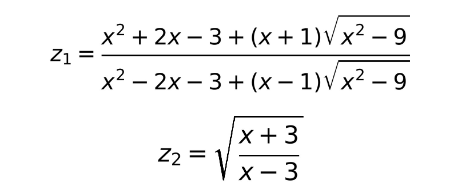

# Transport and Telecommunication Institute

## Programming
## Laboratory Work 1
Calculation of expressions (Variant 16)

Student        : Atakan Bitim
Student Code   : St96516
Group          : 4601BDA

## 1. TASK 

Create an algorithm and a console application in C++ that calculates the values z1 and z2 by the formulas of the individual task. If the calculation are correct, z1 and z2 must be equal (a difference is allowed only in the digits after the decimal point).

The task number is defined by the formula taskNr = studentCode % taskVarCount. There are 20 tasks in total and the last two digits of the student code are 16. So taskNr = 16 % 20 = 16.

Formulas of Variant 16;

  

## 2. Analysis of the task

 The expressions contaion the square root of (x² − 9), therefore x² − 9 ≥ 0, i.e. x ≤ −3 or x ≥ 3. The expression z2 contains the fraction (x+3)/(x-3), therefore x≠3.

 Testing showed that for x < -3 both formulas are defined, but z1 = -z2 (for example, x = -5 gives z1 = -0.5 and z2 = 0.5). The equality z1 = z2 holds only for x > 3, so correct equal results are obtained only for  x > 3. For values outside the domain the program gives no meaningful result for -3 < x < 3 the square root of a negative number is calculated (the result is nan, i.e. not a number), and for x = 3 there is a division by zero (the result is inf).

 ## 3. Algorithm

 Input data: x (real number). Output data: z1, z2.

1- **Start.**
2- **Read the value of x.**
3- **Calculate root = √(x² − 9).**
4. **Calculate z1 = (x² + 2x − 3 + (x + 1)·root) / (x² − 2x − 3 + (x − 1)·root).**
5. **Calculate z2 = √((x + 3)/(x − 3)).**
6. **Print z1 and z2.**
7. **End.**

